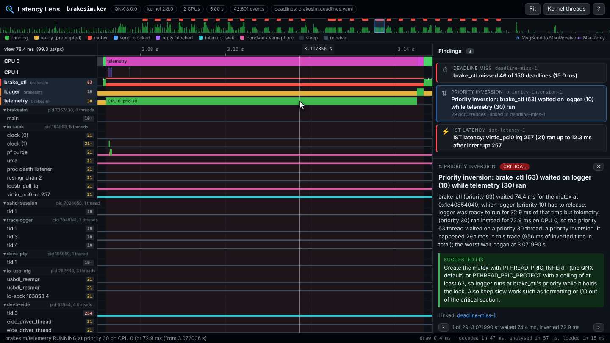
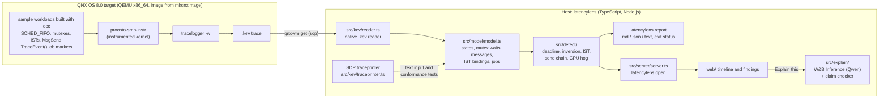

# Latency Lens

Latency Lens reads QNX OS 8.0 kernel event traces (`.kev` files from `tracelogger`) and tells you why a
real-time deadline was missed: a priority inversion, an interrupt service thread held off its CPU, a
request stuck in a chain of message-passing servers, or a thread hogging a core, each with the exact
kernel events as evidence. It shows the trace as a timeline that zooms from seconds to microseconds,
smoothly even with a million events, and can ask an LLM to explain a finding in plain words while code
checks every thread, priority and duration the model mentions against the trace. It runs on the host
as a web UI and a CI-friendly CLI, needs no QNX installation to open a trace, and works fully without
an API key; every trace in this repository was captured on QNX OS 8.0 in QEMU with the QNX SDP 8.0.

**Demo video (2:22):** [demo/video.mp4](demo/video.mp4)



## The problem

When a real-time system on QNX misses a deadline, engineers capture a kernel event trace with
`tracelogger` and then scroll through tens of thousands of events (`traceprinter` prints one line per
event) looking for the moment a high-priority thread waited. The answer is in the trace, but finding it
takes hours and a solid mental model of the QNX scheduler, its mutex protocols, interrupt service
threads and message passing. The classic bugs are easy to write and hard to see: a lock that came over
from a Linux port with `PTHREAD_PRIO_NONE`, an IST that a busier thread outranks, a client blocked behind
a server that is itself blocked on another server.

## What Latency Lens does

- **Reads the trace itself.** A native reader for the QNX 8.0 `.kev` format, verified event by event and
  field by field against the SDP's `traceprinter` on every committed trace. It can also read
  `traceprinter` text directly.
- **Builds a model of what the kernel did:** every thread state with its priority, CPU occupancy,
  mutex waits with their holder (from the owner word `SyncMutexLock` logs), `MsgSend` to `MsgReceive` to
  `MsgReply` transactions, interrupt deliveries and which IST each one woke, and job markers from
  `TraceEvent()`.
- **Five deterministic detectors** report findings with the evidence events, the worst occurrence and
  every other occurrence: deadline miss, priority inversion, IST latency, send-blocked chain, CPU hog.
  They tell scheduling problems apart from platform latency (an emulator or firmware stall) instead of
  blaming a thread for time it could not have used.
- **A timeline UI** (`latencylens open trace.kev`): one lane per CPU and per thread, thread states,
  interrupts, message arrows, an overview strip with every finding; click a finding to jump to its worst
  occurrence with the involved threads pinned. 16 to 24 ms per frame for the whole 1.27 million-event
  stress trace at 1920x1080 (80 lanes), under 1 ms once zoomed in.
- **Checked AI explanations.** "Explain this" sends one finding and only its evidence events to an
  OpenAI-compatible endpoint (W&B Inference, `Qwen/Qwen3.8-27B`, fallback `zai-org/GLM-5.3-Flash`) and
  shows the cause and the fix. Code then checks every thread name, priority, duration, CPU, time and
  mutex-protocol statement in the answer against the trace: matches are underlined in green,
  contradictions struck out in red.
- **A CLI for CI**: `latencylens report trace.kev --deadlines deadlines.yaml --format md` exits with
  status 1 when a deadline was missed.


## QNX technologies used

| QNX technology | What it does here | Files |
| --- | --- | --- |
| QNX SDP 8.0 (`qnxsoftwarecenter_clt`) | Toolchain, target image tools and trace tools, installed in the build session | `docs/build-log.md` |
| `qcc` (gcc 12.2.0, `-Vgcc_ntox86_64`) | Builds the five sample workloads for QNX OS 8.0 x86_64 | `samples/Makefile`, `samples/src/*.c` |
| `mkqnximage` and QEMU x86_64 | Builds and boots the QNX OS 8.0 target the traces were captured on | `scripts/qnx-vm.sh` |
| `tracelogger` | Records wide-mode kernel traces of each workload | `samples/target/capture.sh`, `run-baseline.sh`, `run-stress.sh` |
| `.kev` format and trace event classes | Native binary reader and the model of kernel activity | `src/kev/reader.ts`, `src/kev/constants.ts`, `src/model/model.ts` |
| `traceprinter` | Reference decoder: alternative input, and the conformance tests | `src/kev/traceprinter.ts`, `test/conformance.test.ts` |
| `TraceEvent()`, `trace_logf()` | Job begin and end markers, run notes | `samples/src/brakesim.c`, `src/detect/deadline.ts` |
| SCHED_FIFO, `ThreadCtl()` runmask | Deterministic real-time scenarios; the priorities the detectors reason about | `samples/src/ll_common.h` |
| Mutex protocols (`PTHREAD_PRIO_INHERIT`) | The planted inversion and its one-line fix; the inversion detector | `samples/src/brakesim.c`, `src/detect/inversion.ts` |
| Interrupt service threads (`InterruptAttachThread()`, `InterruptWait()`) | A real IST on the RTC interrupt; the IST latency detector | `samples/src/sensor_ist.c`, `src/detect/ist.ts` |
| Message passing (`MsgSend()`, `MsgReceive()`, `MsgReply()`, `name_attach()`) | A five-process server chain; message arrows and the send-chain detector | `samples/src/send_chain.c`, `src/detect/chain.ts` |

`docs/qnx-features.md` links each item to the QNX 8.0 documentation page it was checked against.

### QNX SDP 8.0, `qcc`, `mkqnximage` and QEMU

`samples/Makefile` builds every sample with `qcc -Vgcc_ntox86_64`. `scripts/qnx-vm.sh image` runs the
SDP's `mkqnximage --type=qemu --arch=x86_64` with an ssh key baked in; `start` boots it in QEMU (KVM when
available, otherwise TCG with `-cpu max,-avx,-avx2`, see the build log) with ssh on port 2222; `ssh`,
`put` and `get` drive the target. The target reports `QNX latencylens 8.0.0 2026/10/30-09:10:05EDT x86pc x86_64`.

### `tracelogger` and the `.kev` format

`samples/target/capture.sh` runs `tracelogger -w -k 32 -b 128 -s <seconds> -f /dev/shmem/<name>.kev` around
a workload; wide mode is what puts priorities in thread events and arguments in kernel calls.
`readKev()` in `src/kev/reader.ts` parses the `TRACE_*` header attributes and the system page, merges
the per-CPU buffers by 64-bit time, reassembles combine events and decodes each class's fields
(`decodeFields()`); it reports dropped buffers. 1,268,250 events (49 MB) decode in about 0.55 s.

### `traceprinter`

The QNX 8.0 SAT guide calls `traceevent_t` partly opaque and points to traceprinter and libtraceparser,
so traceprinter's output is our contract: `readTraceprinter()` in `src/kev/traceprinter.ts` reads its
text (`--decoder traceprinter` runs the SDP tool via `findTraceprinter()` in `src/kev/load.ts`), and
`test/conformance.test.ts` requires the native reader to produce the same events and decoded fields as
traceprinter for every committed trace (`samples/traces/*.traceprinter.txt.gz`).

### Thread, kernel call, interrupt and communication events

`buildModel()` in `src/model/model.ts` turns `THREAD` events into per-thread state runs with priorities,
`SyncMutexLock`/`SyncMutexUnlock`/`SyncCondvarWait` into mutex waits with their holder (the owner word is
`((pid & 0x7fff) << 16) | tid` on 8.0, `ownerKey()`), `MsgSendv`/`MsgReceivev`/`MsgReplyv`/`MsgError` into
transactions keyed by server pid and rcvid, `INT` events into deliveries per CPU, and
`InterruptAttachThread` into IST bindings (`_NTO_INTR_FLAGS_CPU_LOCAL` respected).

### `TraceEvent()` job markers

The samples emit `TraceEvent(_NTO_TRACE_INSERTSUSEREVENT, 100, seq, late_us)` when a periodic job starts
and code 101 when it ends (`brake_ctl()` in `samples/src/brakesim.c`). `jobsForThread()` in
`src/detect/deadline.ts` measures every job from them (or from state changes when a thread has no
markers); `deadlines.yaml` names the periodic threads, their periods, deadlines and marker codes.

### SCHED_FIFO, mutex protocols, ISTs and message passing in the samples

`ll_self()` and `ll_pin_cpu()` in `samples/src/ll_common.h` set `SCHED_FIFO` priorities and runmasks.
`brakesim.c` creates its log mutex with `pthread_mutexattr_setprotocol(&ma, LOG_LOCK_PROTOCOL)`, which
is `PTHREAD_PRIO_NONE` as shipped (the bug). `adc_ist()` in `sensor_ist.c` attaches to the RTC interrupt
(IRQ 8, 512 Hz) with `InterruptAttachThread()` and loops on `InterruptWait()`. `send_chain.c` runs hmi,
route_planner, nav_server, map_db and flash_io as separate processes talking through `name_attach()`,
`name_open()`, `MsgSend()`, `MsgReceive()` and `MsgReply()`.

## Architecture



## Build and run

Requirements: Node.js 20 or newer and pnpm. To capture your own traces you also need the **QNX SDP 8.0**
(free non-commercial license) and **QEMU x86_64**; the samples are built with the SDP's **`qcc`**
toolchain for QNX OS 8.0 x86_64.

```bash
git clone https://github.com/chinesepowered/hack-qnx-latencylens.git
cd hack-qnx-latencylens
pnpm install
pnpm build
```

Open a committed trace (no QNX needed):

```bash
node bin/latencylens.mjs open samples/traces/inversion.kev
```

Report for CI (exit status 1 on a missed deadline, 0 when clean, 2 on errors):

```bash
node bin/latencylens.mjs report samples/traces/inversion.kev --format md
```

Explain a finding with an LLM: put `OPENAI_BASE_URL`, `OPENAI_API_KEY`, `OPENAI_MODEL` (and optionally
`OPENAI_FALLBACK_MODEL`) in `.env` in the working directory or a parent, then click "Explain this" in the
UI or run:

```bash
node bin/latencylens.mjs explain samples/traces/inversion.kev --finding priority-inversion-1
```

Capture traces on QNX OS 8.0 in QEMU (QNX SDP 8.0 in `~/qnx800`):

```bash
source ~/qnx800/qnxsdp-env.sh
make -C samples                      # qcc -Vgcc_ntox86_64 for every sample
scripts/qnx-vm.sh image              # mkqnximage --type=qemu --arch=x86_64
scripts/qnx-vm.sh start              # boots QEMU x86_64, ssh on port 2222
scripts/capture-samples.sh           # runs each sample under tracelogger, pulls the .kev files back
```

The codelab walks through the whole loop step by step with the expected output of every command:
[Find a priority inversion on QNX in 20 minutes](https://chinesepowered.github.io/hack-qnx-latencylens/)
(source in `codelab/`).

Tests: `pnpm test` (36 tests: traceprinter conformance on six traces and the 1.27M-event stress trace,
every detector against its planted problem and the clean baseline, and the claim checker rejecting wrong
numbers and invented mutex protocols). `pnpm check` adds the type check and the repository guards.

## What each detector finds in the sample traces

All traces are real captures from QNX OS 8.0 in QEMU x86_64 (2 CPUs), in `samples/traces/` and
`demo/traces/`. Analysis takes 40 to 170 ms per sample trace and 1.9 s for the stress trace.

| Trace | Workload | Findings |
| --- | --- | --- |
| `inversion.kev` | brake_ctl (63), telemetry (30), logger (10) on CPU 0, log mutex with `PTHREAD_PRIO_NONE` | **Deadline miss**: brake_ctl missed 35 of 150 deadlines (15 ms). **Priority inversion**: brake_ctl (63) waited on logger (10) while telemetry (30) ran |
| `inversion-fixed.kev` | the same program with `PTHREAD_PRIO_INHERIT` | none |
| `ist-latency.kev` | adc_ist (40) on RTC IRQ 8, video_enc (50) on the same CPU | **IST latency**: adc_ist ran up to 10.8 ms after interrupt 8, held off by video_enc |
| `send-chain.kev` | hmi, nav_server, map_db, flash_io processes over `MsgSend` | **Send-blocked chains**: hmi -> nav_server -> map_db -> flash_io (33.0 ms) and route_planner -> map_db -> flash_io (13.4 ms) |
| `cpu-hog.kev` | diag_scan (40) burning CPU 0 under sensor_poll and can_rx | **CPU hog**: diag_scan held CPU 0 for 430 ms (98%); **deadline misses** for sensor_poll (537 of 600) and can_rx (254 of 300), linked to the hog |
| `baseline.kev` | all patterns, correctly prioritised | none (54,345 events) |
| `stress.kev.gz` | everything at once for 21 s, 1,268,250 events | deadline miss (206 of 900), priority inversion, two send-blocked chains; kernel-internal and platform delays listed as notes |
| `demo/traces/brakesim.kev` | the demo video's capture | deadline miss (46 of 150, worst 75.4 ms), priority inversion (29 times, worst wait 74.4 ms), IST latency of io-sock's virtio IST (21) behind telemetry (30) |
| `demo/traces/fixed.kev` | after the one-line fix | none: 0 misses, worst response 4.56 ms; the logger runs at priority 63 in all 27 of brake_ctl's mutex waits (median wait 1.61 ms) |

Each finding links to related ones (a deadline miss to the inversion that caused it), lists every
occurrence, and names the measured facts the AI explanation is checked against.

## How the AI explanation is kept honest

`buildPrompt()` in `src/explain/explain.ts` sends the finding's facts and its evidence events only, and
asks for a CAUSE and a FIX. `checkClaims()` in `src/explain/claims.ts` then extracts every thread name,
priority, duration, CPU number, count and time from the answer and compares it with the evidence and
the measured facts (`buildClaimContext()`), within the precision the model wrote. It also checks what
the answer says about the mutex protocol against what the kernel did: with `PTHREAD_PRIO_INHERIT`, or a
`PTHREAD_PRIO_PROTECT` ceiling at the waiter's priority, the holder would have run at the waiter's
priority, and the trace shows whether it did. Negations ("lacks priority inheritance") and hypotheticals
("would have prevented") are read as such. Numbers and protocols in the FIX are proposals, not claims
about the trace. The checker verifies facts, not the reasoning that connects them.

The recorded answer in `samples/traces/inversion.explanations.json` shows both checks at work: it says
the mutex "uses the default `PTHREAD_PRIO_INHERIT` protocol" and that the logger's priority "was
temporarily raised to 63", and both claims are struck out because the logger stayed at priority 10.
`latencylens explain --save` records an answer and `--recorded` replays it, so the committed answers can
be checked without a key.


## Repository layout

| Path | Contents |
| --- | --- |
| `src/kev/` | `.kev` reader, traceprinter reader, event tables |
| `src/model/` | the model of kernel activity built from a trace |
| `src/detect/` | the five detectors |
| `src/explain/` | prompt, OpenAI-compatible client, claim checker |
| `src/server/`, `web/` | `latencylens open`: local server and the timeline UI |
| `src/report/`, `src/cli.ts` | reports and the command line |
| `samples/` | sample workloads (C, qcc), target scripts, captured traces |
| `scripts/` | QEMU VM driver, capture and repository checks |
| `test/` | conformance, detector, stress and claim checker tests |
| `codelab/` | the codelab, published to GitHub Pages |
| `demo/` | the video, its narration script, recorded terminal sessions and the renderer |
| `docs/` | build log, QNX features, Devpost text, screenshots |

## License

GNU Affero General Public License v3.0 or later, see `LICENSE`. The QNX SDP is not part of this
repository; the `.kev` traces are our own captures.
