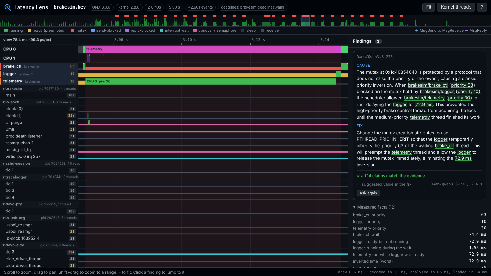
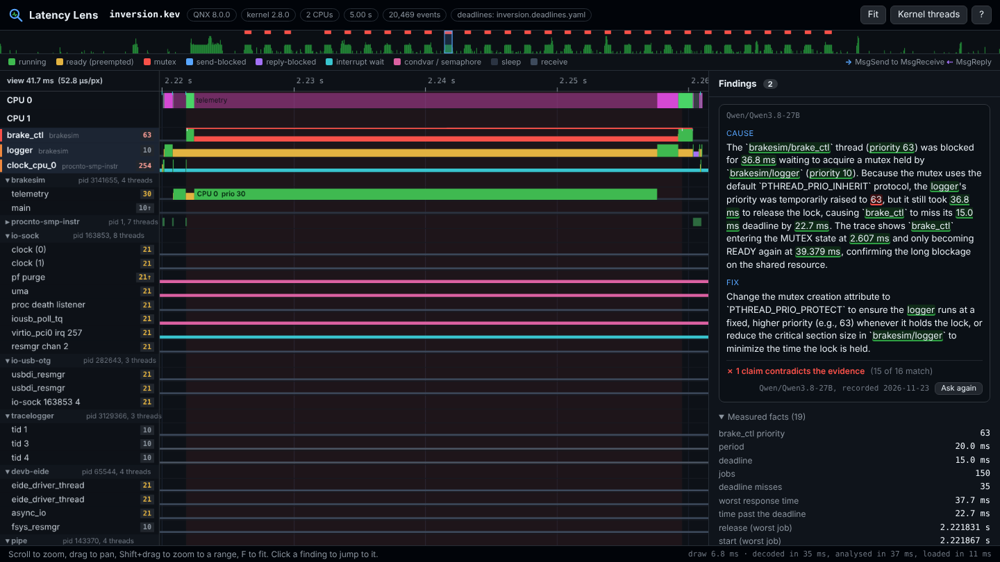
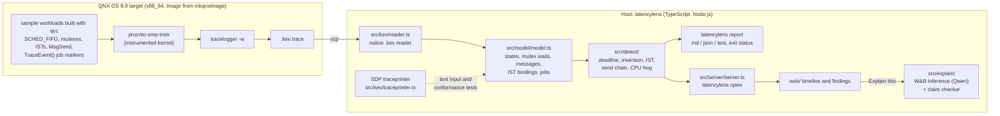

# Latency Lens

**Find out why a QNX real-time thread missed its deadline in seconds instead of hours.** Latency Lens reads QNX OS 8.0
kernel event traces, draws them as a timeline that zooms from seconds to microseconds, and runs five detectors that
name the cause: a priority inversion, an interrupt service thread held off its CPU, a chain of blocked message-passing
servers, a CPU hog or a missed deadline, each with the exact kernel events as evidence. One click asks an LLM to
explain the finding in plain words, and code checks every thread, priority and duration it mentions against the
trace. It runs as a local web app and a CI command, opens traces without a QNX installation, and comes with a
20-minute codelab.

**Video:** https://youtu.be/jl7NuoTHKk4 · **Codelab:** https://chinesepowered.github.io/hack-qnx-latencylens/ ·
**Devpost:** https://devpost.com/software/latency-lens-8uj1i5


## The problem

When a real-time system on QNX misses a deadline, engineers capture a kernel event trace with `tracelogger` and then
scroll through tens of thousands of lines of `traceprinter` output looking for the moment a high-priority thread
waited. The answer is in the trace, but finding it takes hours and a deep mental model of the QNX scheduler, mutex
protocols, interrupt service threads and message passing. The classic bugs are easy to write and hard to see: a lock
carried over from a Linux port with `PTHREAD_PRIO_NONE`, an IST outranked by a busier thread, a client blocked behind a
server that is itself blocked on another server. In cars, medical devices and factories, each of those is a missed
deadline in the field.

## Our solution

- **Reads the trace itself.** A native reader for the QNX 8.0 `.kev` format, verified event by event and field by
  field against the SDP's `traceprinter` on every committed trace. It also accepts `traceprinter` text.
- **Models what the kernel did.** Every thread state with its priority, CPU occupancy, mutex waits with their holder,
  `MsgSend` to `MsgReceive` to `MsgReply` transactions, interrupt deliveries and the IST each one woke, and job markers
  from `TraceEvent()`.
- **Five deterministic detectors**: deadline miss, priority inversion, IST latency, send-blocked chain and CPU hog.
  Each finding carries its evidence events, the worst occurrence and every other occurrence, and links to related
  findings (a deadline miss to the inversion that caused it). Kernel-internal and platform delays are reported as
  such, so a thread is never blamed for time it could not have used.
- **A timeline built for big traces** (`latencylens open trace.kev`): one lane per CPU and per thread, thread states,
  interrupts and message arrows. Click a finding to jump to its worst occurrence with the involved threads pinned.
- **Checked AI explanations.** "Explain this" sends one finding and only its evidence to W&B Inference and shows the
  cause and the fix, with every claim underlined in green when it matches the trace or struck out in red when it does
  not.
- **A CI gate**: `latencylens report trace.kev --deadlines deadlines.yaml --format md` exits with status 1 when a
  deadline was missed.



## Results

**The demo, end to end.** A brake controller at priority 63 missed 46 of 150 deadlines (worst 75.4 ms). Latency Lens
traced it to a priority inversion that happened 29 times: the brake waited on a log mutex held by a priority-10
logger while a priority-30 telemetry thread ran. After the one-line `PTHREAD_PRIO_INHERIT` fix: 0 misses, worst
response 4.56 ms, and the trace shows the logger running at priority 63 in all 27 of the brake's mutex waits.

**Fast on real traces.** A 1,268,250-event trace is analysed in 1.94 s. The timeline draws the whole trace in 16 to 24
ms per frame at 1920x1080 and under 1 ms once zoomed in. Sample traces take 40 to 170 ms.

**What each detector finds** in traces captured on QNX OS 8.0 (in `samples/traces/` and `demo/traces/`):

| Trace | Workload | Findings |
| --- | --- | --- |
| `inversion.kev` | brake_ctl (63), telemetry (30), logger (10), log mutex with `PTHREAD_PRIO_NONE` | **Deadline miss**: 35 of 150 (15 ms). **Priority inversion**: brake_ctl waited on logger while telemetry ran |
| `inversion-fixed.kev` | the same program with `PTHREAD_PRIO_INHERIT` | none |
| `ist-latency.kev` | adc_ist (40) on RTC IRQ 8, video_enc (50) on the same CPU | **IST latency**: adc_ist ran up to 10.8 ms after interrupt 8, held off by video_enc |
| `send-chain.kev` | hmi, nav_server, map_db and flash_io over `MsgSend` | **Send-blocked chains**: hmi to nav_server to map_db to flash_io (33.0 ms), route_planner to map_db to flash_io (13.4 ms) |
| `cpu-hog.kev` | diag_scan (40) burning CPU 0 | **CPU hog**: diag_scan held CPU 0 for 430 ms (98%); **deadline misses** of sensor_poll and can_rx linked to it |
| `baseline.kev` | every pattern, correctly prioritised | none |
| `stress.kev.gz` | everything at once, 1,268,250 events | deadline miss, priority inversion, two send-blocked chains |

## QNX technologies used

| QNX technology | What it does in Latency Lens | Where |
| --- | --- | --- |
| `tracelogger` | Captures wide-mode kernel traces of each workload | `samples/target/capture.sh` |
| `.kev` format and trace event classes | Native reader and the model of kernel activity | `src/kev/reader.ts`, `src/model/model.ts` |
| `traceprinter` | Alternative input and the reference for the conformance tests | `src/kev/traceprinter.ts`, `test/conformance.test.ts` |
| `TraceEvent()` user events | Job start and end markers that deadlines are measured from | `samples/src/brakesim.c`, `src/detect/deadline.ts` |
| Mutex protocols (`PTHREAD_PRIO_INHERIT`) | The planted inversion, its fix, and the inversion detector | `samples/src/brakesim.c`, `src/detect/inversion.ts` |
| Interrupt service threads (`InterruptAttachThread()`, `InterruptWait()`) | A real IST on the RTC interrupt and the IST latency detector | `samples/src/sensor_ist.c`, `src/detect/ist.ts` |
| Neutrino message passing (`MsgSend()`, `MsgReceive()`, `MsgReply()`, `name_attach()`) | A five-process server chain and the send-chain detector | `samples/src/send_chain.c`, `src/detect/chain.ts` |
| SCHED_FIFO and `ThreadCtl()` runmasks | The priorities and CPUs the detectors reason about | `samples/src/ll_common.h` |
| QNX SDP 8.0, `qcc` and `mkqnximage` | Builds the sample workloads and the QNX OS 8.0 target they run on | `samples/Makefile`, `scripts/qnx-vm.sh` |

[docs/qnx-features.md](docs/qnx-features.md) links every item to the QNX 8.0 documentation page it was built against.

## How Latency Lens uses each QNX technology

### `tracelogger`

`samples/target/capture.sh` runs `tracelogger -w -k 32 -b 128 -s <seconds> -f /dev/shmem/<name>.kev` around a workload.
Wide mode is what puts priorities in thread events and arguments in kernel calls, which is what the detectors need.

### The `.kev` format and trace event classes

`readKev()` in `src/kev/reader.ts` parses the `TRACE_*` header attributes and the system page, merges the per-CPU
buffers by 64-bit time, reassembles combine events and decodes each class's fields (`decodeFields()`), reporting any
dropped buffers. `buildModel()` in `src/model/model.ts` turns `THREAD` events into state runs with priorities,
`SyncMutexLock`, `SyncMutexUnlock` and `SyncCondvarWait` into mutex waits with their holder (the 8.0 owner word
`((pid & 0x7fff) << 16) | tid`), `MsgSendv`, `MsgReceivev` and `MsgReplyv` into transactions, `INT` events into
deliveries, and `InterruptAttachThread` into IST bindings. 1,268,250 events decode in about 0.55 s.

### `traceprinter`

`readTraceprinter()` in `src/kev/traceprinter.ts` reads traceprinter's text, and `--decoder traceprinter` runs the SDP
tool directly (`findTraceprinter()` in `src/kev/load.ts`). `test/conformance.test.ts` requires the native reader to
produce exactly the events and decoded fields traceprinter produces, on every committed trace.

### `TraceEvent()` job markers

The samples emit `TraceEvent(_NTO_TRACE_INSERTSUSEREVENT, 100, seq, late_us)` when a periodic job starts and code 101
when it ends (`brake_ctl()` in `samples/src/brakesim.c`). `jobsForThread()` in `src/detect/deadline.ts` measures every
job from them, or from state changes when a thread has no markers; `deadlines.yaml` names the periodic threads, their
periods and deadlines.

### Mutex protocols

`brakesim.c` creates its log mutex with `pthread_mutexattr_setprotocol()`: `PTHREAD_PRIO_NONE` in the buggy build,
`PTHREAD_PRIO_INHERIT` in the fixed one. `detectInversions()` in `src/detect/inversion.ts` finds a high-priority waiter,
the low-priority holder and the medium-priority thread that ran in between, and the claim checker knows what each
protocol would have done to the holder's priority.

### Interrupt service threads

`adc_ist()` in `samples/src/sensor_ist.c` attaches to the RTC interrupt (IRQ 8, 512 Hz) with
`InterruptAttachThread()` and loops on `InterruptWait()`, the QNX 8.0 model that replaces ISRs. `detectIstLatency()` in
`src/detect/ist.ts` measures from each interrupt to the IST running and names the thread that held it off.

### Neutrino message passing

`send_chain.c` runs hmi, route_planner, nav_server, map_db and flash_io as separate processes talking through
`name_attach()`, `name_open()`, `MsgSend()`, `MsgReceive()` and `MsgReply()`. The timeline draws each transaction as an
arrow, and `detectChains()` in `src/detect/chain.ts` follows send-blocked threads server to server to the one doing the
work.

### SCHED_FIFO and runmasks

`ll_self()` and `ll_pin_cpu()` in `samples/src/ll_common.h` set SCHED_FIFO priorities and `ThreadCtl()` runmasks, which
make every scenario deterministic and give the detectors the priorities and CPUs they reason about.

### QNX SDP 8.0, `qcc` and `mkqnximage`

`samples/Makefile` builds every workload with `qcc -Vgcc_ntox86_64`. `scripts/qnx-vm.sh image` runs the SDP's
`mkqnximage --type=qemu --arch=x86_64`, and `start`, `ssh`, `put` and `get` boot and drive the QNX OS 8.0 target the
traces are captured on.

## How the AI explanation stays honest

`buildPrompt()` in `src/explain/explain.ts` sends only the finding's facts and evidence events and asks for a cause and
a fix. `checkClaims()` in `src/explain/claims.ts` extracts every thread name, priority, duration, CPU, count and time in
the answer and compares it with the evidence, within the precision the model wrote. It also checks statements about the
mutex protocol against what the kernel actually did: with priority inheritance the holder would have run at the
waiter's priority, and the trace shows whether it did. A recorded answer in
`samples/traces/inversion.explanations.json` shows the checker striking out two confident but false claims, so a
developer sees at a glance which parts of an explanation to trust.



## Architecture



## Build and run

Requirements: Node.js 20 or newer and pnpm. To capture your own traces: **QNX SDP 8.0** (free non-commercial license),
its **`qcc`** toolchain for QNX OS 8.0 x86_64, and **QEMU x86_64**.

```bash
git clone https://github.com/chinesepowered/hack-qnx-latencylens.git
cd hack-qnx-latencylens
pnpm install && pnpm build
node bin/latencylens.mjs open samples/traces/inversion.kev                  # timeline at http://127.0.0.1:7878/
node bin/latencylens.mjs report samples/traces/inversion.kev --format md    # exit status 1: deadline missed
pnpm test                                                                   # 36 tests
```

Explain a finding: put `OPENAI_BASE_URL`, `OPENAI_API_KEY` and `OPENAI_MODEL` in `.env`, then click "Explain this" or
run `node bin/latencylens.mjs explain samples/traces/inversion.kev --finding priority-inversion-1`.

Capture traces on QNX OS 8.0:

```bash
source ~/qnx800/qnxsdp-env.sh
make -C samples                      # qcc -Vgcc_ntox86_64 for every sample
scripts/qnx-vm.sh image              # mkqnximage --type=qemu --arch=x86_64
scripts/qnx-vm.sh start              # boots the QNX target, ssh on port 2222
scripts/capture-samples.sh           # runs each sample under tracelogger, pulls the .kev files back
```

## Codelab

[Find a priority inversion on QNX in 20 minutes](https://chinesepowered.github.io/hack-qnx-latencylens/) walks through
the whole loop: build a program with a hidden inversion, capture a trace on QNX OS 8.0, find the inversion in Latency
Lens, fix it with `PTHREAD_PRIO_INHERIT`, and confirm the clean trace. Every command and its expected output come from
a run on a freshly built QNX image. Source in `codelab/`.

## Repository layout

| Path | Contents |
| --- | --- |
| `src/kev/` | `.kev` reader, traceprinter reader, event tables |
| `src/model/` | The model of kernel activity built from a trace |
| `src/detect/` | The five detectors |
| `src/explain/` | Prompt, OpenAI-compatible client, claim checker |
| `src/server/`, `web/` | `latencylens open`: local server and timeline UI |
| `src/report/`, `src/cli.ts` | Reports and the command line |
| `samples/` | Sample workloads (C, `qcc`), target scripts, captured traces |
| `test/` | Conformance, detector, stress and claim checker tests |
| `codelab/` | The codelab, published to GitHub Pages |
| `docs/` | QNX features used, build log, screenshots |

## License

GNU Affero General Public License v3.0 or later, see [LICENSE](LICENSE). The QNX SDP is not part of this repository;
the `.kev` traces are our own captures.
